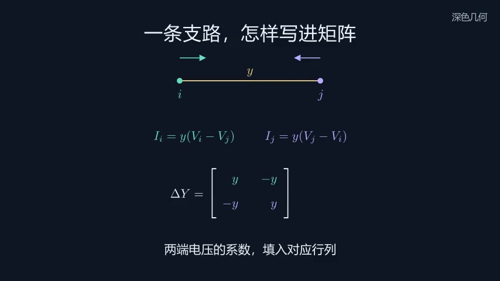
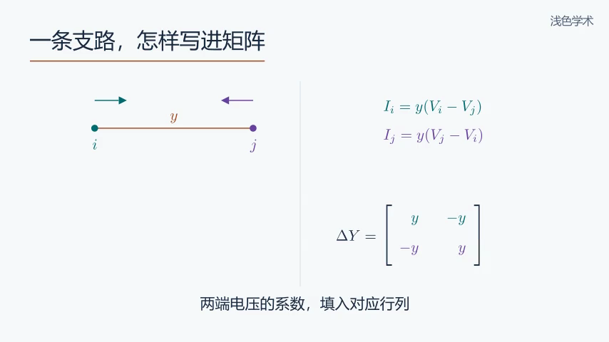
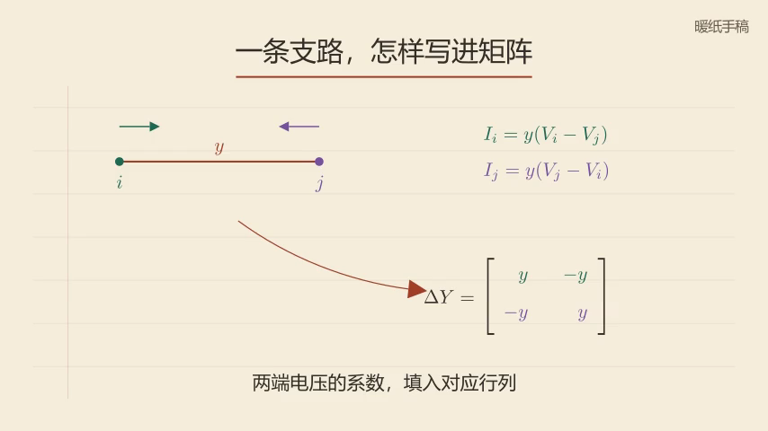

# build-manim-decks

把论文、课件、讲稿或一个主题，做成能跟着看懂的 Manim 动画。

[](https://github.com/ReaperWLLLLL/build-manim-decks/actions/workflows/ci.yml)
[](LICENSE)

这个 Skill 帮助 AI 和使用者一起设计解释过程：先选好例子，让观众看见对象怎样变化，再把变化对应到公式。它适合数学推导、网络关系、算法过程，以及需要动画才能讲清的课程内容。

项目仍在迭代。已有论文演示和课程动画的制作经验，但不同题材的效果还需要实际尝试。欢迎贡献教学案例、风格方案和具体的修复。

## 三套视觉风格

下面用同一个原创例子比较三套风格：从一条支路的两端电流，写出它对节点导纳矩阵的贡献。图像由仓库中的 Manim 代码实际渲染，未使用课件截图。

| 深色几何 `midnight` | 浅色学术 `daylight` | 暖纸手稿 `notebook` |
| --- | --- | --- |
|  |  |  |
| 深蓝底、居中构图，颜色突出正在变化的对象 | 冷白底、左对齐标题，图形与推导分栏 | 暖纸底、墨色线条，边注与弧线串起推导 |
| 适合几何、机制和连续视频 | 适合课堂投影、学术报告 | 适合逐步演算、教程 |

三套风格的字号、线宽、布局和强调方式都可以复用，也允许根据内容调整。中文默认使用本机合法安装的微软雅黑；公式使用 `MathTex`。风格选择不限制算例规模。

<details>
<summary>展开观看三套动画</summary>

深色几何：


浅色学术：


暖纸手稿：


</details>

风格说明见 [visual-styles.md](references/visual-styles.md)，可复用参数见 [styles.py](assets/native-example/styles.py)，完整示例见 [style_showcase.py](assets/native-example/style_showcase.py)。

## 当前流程

1. **讨论教学设计。** 确认听众、学习目标、深度、时长和输出格式；一起决定主例需要保留哪些结构、可以做哪些简化，以及采用哪套风格。已经确认的答案会继续沿用。
2. **阅读材料，组织分镜。** 整章内容先梳理知识覆盖。每个场景说明观众跟随什么对象、执行什么操作、由此理解什么关系。可以调整讲解次序，不必一页课件对应一幕。
3. **制作代表性低清样片。** 优先选择最难解释的一段。使用者判断算例是否合适、动效是否有帮助，再据此调整。
4. **完成连续动画。** 保持节点、符号、颜色和参考方向一致，用公式变换、对象移动和局部聚焦展开推导。
5. **检查与交付。** 核对数学含义、排版、遮挡和密集画面，检查视频能否完整解码。交付源码和复现命令；按需追加配音、HTML 或视频型 PPT。

默认先讨论设计并审阅样片。使用者已经授权全量制作或明确委托选择时，按约定继续，不重复确认。技术检查与人的审阅分别记录；抽帧检查不等于连续看过整片。

入口是 [SKILL.md](SKILL.md)。默认使用[创作流程](references/creative-first.md)和[原生 Manim](references/native-manim.md)，整章任务补读[章节制作](references/chapter-production.md)。

## Skill 会帮助约束什么

画面可以简洁，例子仍应保留教学目标需要的结构。选择五节点还是更大网络，要由内容决定。动画应解释关系：例如把支路电流式里的系数移动到矩阵对应位置，让观众看见符号的来处。

屏幕文字描述眼前的动作。详细来源核查和制作记录留在备注中，科学结论需要的条件仍要说清。文字经过 Humanizer 和 Humanizer-zh 复核；环境里没有这两个 Skill 时，按[文字复核说明](references/text-humanization.md)进行人工编辑并说明情况。仓库不捆绑上游 Skill。

句子里的公式也使用数学排版，例如树支子矩阵的下标与矩阵转置应有区别。写场景时参考[文字与公式混排](references/copy-and-math.md)。

先做好视觉解释，再安排配音。讲稿跟随已确认的画面和停顿；配音、音乐和音效均按需求启用。普通创作使用代表性画面检查，最终教学效果由人审阅。

## 安装与环境

把仓库放到当前 AI 工具的 Skill 目录中，或在对话中提供 `SKILL.md` 的路径。Codex 默认目录的安装示例：

```bash
git clone https://github.com/ReaperWLLLLL/build-manim-decks.git \
  ~/.codex/skills/build-manim-decks
cd ~/.codex/skills/build-manim-decks
python3.11 -m venv .venv
source .venv/bin/activate
python -m pip install -r requirements.txt
```

Windows PowerShell 使用 `.venv\Scripts\Activate.ps1` 激活环境。已有安装且工作区干净时，可在仓库目录运行 `git pull --ff-only` 更新；有本地修改时先保留自己的改动。

本项目使用 Manim Community Edition，当前依赖范围为 0.20.x。本地渲染还需要 Cairo/Pango、FFmpeg/FFprobe；示例中的公式需要 LaTeX。系统组件按 [Manim 官方说明](https://docs.manim.community/en/stable/installation.html)安装。普通无声动画无需语音模型或 GPU。

```bash
python scripts/preflight.py --need-latex
# 读取 PDF、导出 PPTX 时再增加 --need-pdf-input 或 --need-pptx
```

中文默认字体为 Microsoft YaHei，需自行合法安装，也可以指定其他已安装中文字体。仓库不提供字体下载或字体文件。

## 怎样使用

在独立项目目录里存放材料，再把下面的提示交给 AI：

```text
使用 $build-manim-decks，把这份课件做成中文无声讲解视频。
听众是相关方向研究生，目标是理解物理意义并能跟着推导。
时长不超过 20 分钟，使用符号推导，暂不代入具体数值。
采用 daylight 浅色学术风格。
先和我确认主例的结构与简化方式，再给出分镜和低清样片。
样片认可后完成全量视频，交付连续 MP4、HTML 预览和源码。
材料仅供本地使用，不要上传原文。
```

只有主题也可以开始，例如“讲解傅里叶变换，让学过微积分的学生理解频域的含义”。不确定怎么选例子或风格时，让 AI 提供方案和取舍。你不需要先写代码，主要判断解释是否准确、深度是否合适、样片是否讲明白。

修改已有作品时，提供源码与视频，指出位置和希望改善的理解过程。例如“在第二节推导里，让矩阵每一项与对应支路同步高亮”。Skill 会先检查原场景，再修改受影响的部分。

## 运行三套风格示例

在已激活环境的仓库根目录运行：

```bash
python -m manim -ql --disable_caching --media_dir build/style-demo \
  assets/native-example/style_showcase.py Midnight Daylight Notebook
```

命令会输出三个低清无声视频，路径显示在 Manim 日志中。只想看一套时，保留对应的类名即可。需要更清楚的预览时，把 `-ql` 改成 `-r 1280,720 --fps 30`。

字体已安装但未被发现时，设置 `MANIM_CHINESE_FONT_FILE` 为本机字体路径；换字体时再设置 `MANIM_CHINESE_FONT` 为字体家族名。示例会报告缺失的字体，不会自动下载。实际项目放在 Skill 目录外，复制需要的示例和参数即可。

## 输出与兼容路线

| 需求 | 路线与交付 |
| --- | --- |
| 无声样片、完整讲解视频 | 默认原生 Manim；连续 MP4、场景源码和复现命令 |
| HTML 预览 | 按需包装视频或章节，说明媒体是否随页面一起分发 |
| 视频型 PPT | 每页嵌入无声切片，提供海报帧和讲稿备注；Manim 对象不会变成可编辑的 PPT 形状 |
| 静态 PDF | 选取关键帧，用于阅读和打印 |
| 配音 | 视觉确认后按画面编写讲稿，使用项目指定的声音和后端；需要实际试听 |
| 已有 `schema_version: "0.1"` 演示稿 | 保留[旧版逐页工作流](references/workflow.md)与 HTML/PPTX/PDF 导出工具 |
| 已有 `schema_version: "0.2"` 或明确需要严格同步 | 使用 [research-video](references/research-video.md) 的音频、时间轴和逐帧检查合同 |

普通原生场景不要求先编写 `deck.yaml`。`scaffold_project.py` 创建的是旧版 v0.1 项目；`build_research.py` 服务于严格 v0.2 项目，不能把任意原生场景直接当作其输入。三套新风格用于原生场景，旧版主题名称保持兼容。

后期说明见 [post-production.md](references/post-production.md)。软件封装检查不能代替实际 PowerPoint 或浏览器播放，交付时会说明哪些播放器已验证。

## 较早的论文演示

下面是项目此前制作的 *Attention Is All You Need* 中文导读，展示逐页演示路线。图形由 Manim 解释性重绘，仓库没有论文 PDF、页面截图或全文提取物。


三套风格示例与旧演示的来源说明见 [demo provenance](assets/demo/README.md)。

## 私有材料与开源范围

课件、论文原文和全文提取结果放在项目的 `.private/` 目录。公开代码只保留必要的书目信息、出处定位、独立撰写的说明和有权分发的素材。不要提交页面截图、私人讲稿、SSH 配置、克隆声音样本、模型权重或专有字体。

本仓库发布通用 Skill、工具、测试及原创示例，不包含本地课程项目、个人服务器配置和开发过程记录。`.gitignore` 只是辅助措施：上传前还要检查实际提交和新增历史；打 ZIP 时检查实际归档内容。

源码采用 [MIT License](LICENSE)，依赖与外部素材各自保留许可证，见 [THIRD_PARTY_NOTICES.md](THIRD_PARTY_NOTICES.md) 和[发布边界](references/licensing-and-publication.md)。

## 开发与贡献

轻量测试不需要语音模型或真实 SSH：

```bash
python -m pip install -r requirements-dev.txt
python -m pytest -q tests/test_core.py tests/test_research_spec.py \
  tests/test_research_themes.py tests/test_research_layout.py \
  tests/test_research_timeline.py tests/test_research_voice.py tests/test_native_styles.py
python scripts/audit_release.py --ref HEAD
```

GitHub CI 运行上述轻量测试和发布文件检查。完整 `python -m pytest -q` 还包含媒体与渲染测试，需要 FFmpeg、TeX、Manim 和可用字体；CI 通过不代表所有渲染或播放器都已测试。提交前可用 `audit_release.py --ref INDEX` 检查暂存文件，再对提交后的 `HEAD` 检查。

欢迎提交最小复现、带说明的动画案例，或一处具体的教学改进。涉及视觉的改动，请附前后画面和复现命令；示例使用自写或许可明确的输入。项目依赖 Manim CE 和 Manim Slides，文字编辑方法参考 Humanizer、Humanizer-zh 与 Stop Slop，未捆绑这些项目的 Skill 文件。
