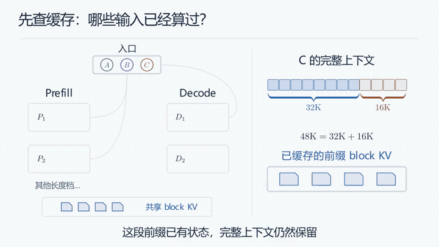

# MIM · Make Ideas Move

用 Manim 动画讲清研究成果、技术方案、论文或一个想法。

MIM 是一套给 AI 使用的 Skill。你提供材料和想传达的观点，AI 与你讨论讲解思路，再制作动画、视频或内嵌动画的 PPT。课程讲解也是其中一种用途。

项目仍在迭代，欢迎分享使用案例、反馈问题和参与改进。

## 效果预览

三个示例均为无声完整视频。MP4 统一使用 `mim-demo-序号-主题.mp4` 命名，按高网、DeepInfer、神经网络排列；可在[示例视频发布页](https://github.com/ReaperWLLLLL/MIM/releases/tag/demo-videos-2026-10-25)下载。

### 示例 01 · 高网：树支、连支与 A/B/Q 矩阵

从树支、连支和割集，走到图与 A、B、Q 矩阵的对应关系。约 3 分 42 秒，720p / 30 fps。[下载完整 MP4](https://github.com/ReaperWLLLLL/MIM/releases/download/demo-videos-2026-10-25/mim-demo-01-circuit-network.mp4)。

https://github.com/user-attachments/assets/8bffd351-8f4e-4719-930c-e759f818a6c2

### 示例 02 · DeepInfer：生产集群调度

跟随短请求、长请求和带缓存前缀的请求，观察缓存复用、Prefill 分配与分块、KV 交接、Decode 选路和流式返回。3 分钟，720p / 30 fps。依据官方公开部署说明绘制，负载数值用于讲解，不是生产性能测试。

上图为 12 秒片段预览。[下载完整 MP4](https://github.com/ReaperWLLLLL/MIM/releases/download/demo-videos-2026-10-25/mim-demo-02-deepinfer.mp4)。

### 示例 03 · 神经网络：两路梯度回传

跟随一条权重，观察前向计算、两路梯度汇合与参数更新。3 分钟，720p / 30 fps。[下载完整 MP4](https://github.com/ReaperWLLLLL/MIM/releases/download/demo-videos-2026-10-25/mim-demo-03-neural-network.mp4)。

https://github.com/user-attachments/assets/a3df5c9e-c3d4-4d22-8d98-9f2a1678818f

视频中的图形与解释为重新制作，未上传私人课件或论文原文。[示例来源与文件记录](assets/demo/README.md)。

### 三种视觉风格

同一个支路与矩阵的讲解，可以采用三种风格：

| 深色几何 | 浅色学术 | 暖纸手稿 |
| --- | --- | --- |
|  |  |  |
| 深蓝底、居中构图，突出对象变化 | 浅色底、图形与推导分栏，适合学术汇报 | 暖纸底、边注与弧线，适合展开思路 |

## 流程

1. 与 AI 确认听众、核心观点、讲解深度、时长和风格。
2. AI 阅读材料、组织分镜，制作一段低清样片供你审阅。
3. 根据反馈调整，再完成全量内容。
4. 检查画面与表达，交付视频、PPT 或 HTML；配音按需添加。

## 安装

把这句话发给支持 Skill 的 AI 助手：

> 为我安装 MIM 并生成一个简单示例，仓库地址：[https://github.com/ReaperWLLLLL/MIM](https://github.com/ReaperWLLLLL/MIM)

## 怎样使用

安装后，用 $mim 调用，再说明材料、听众和讲解目标。例如：

> 使用 $mim，把我的研究稿和实验结果做成约 12 分钟的中文动态汇报。听众是相关领域同行，重点讲清方法的新意和结果支持的结论。采用浅色学术风格，先和我讨论主线，再做样片；认可后交付内嵌无声动画的 PPT 和 HTML 预览。

只有主题也可以开始：

> 使用 $mim，向跨专业合作者讲清这个优化方法怎样处理约束。先帮我选择合适的讲解思路和视觉风格。

你不需要编写代码。告诉 AI 想讲什么、给谁看、希望对方理解什么，再通过样片一起调整。私人研究稿和课件仅供本地制作，未经授权不公开上传。
